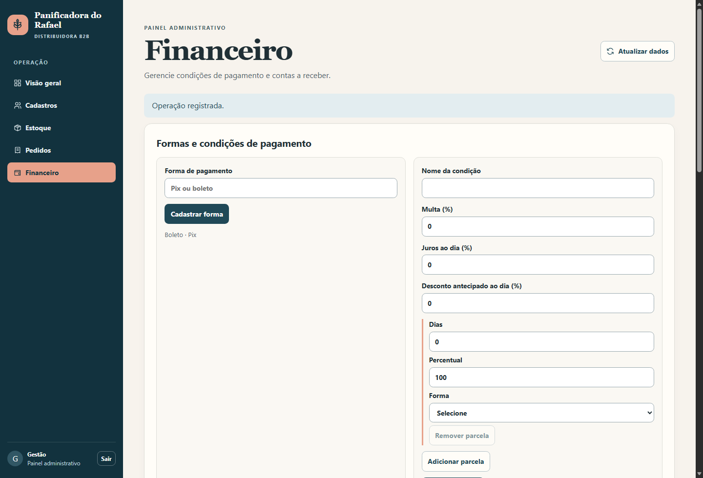
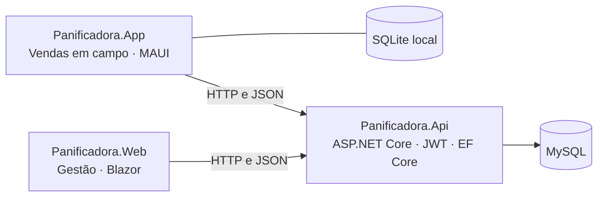

<div align="center">

# Panificadora do Rafael

**Gestão B2B para uma distribuidora de produtos de panificação**

Pedidos em campo, estoque por validade e contas a receber.


[Visão geral](#visão-geral) · [Arquitetura](#arquitetura) · [Como executar](#como-executar) · [Testes](#testes)

</div>



*Painel em execução com dados fictícios. [Tela de acesso](docs/imagens/acesso-web.png) · [Fila de envio no Android](docs/imagens/fila-android.png).*

## Visão geral

A distribuidora vende insumos de panificação a empresas. O vendedor consulta sua carteira, segue o roteiro do dia e registra clientes e pedidos em campo. Na central, a equipe reúne os pedidos, decide as quantidades a liberar e acompanha o estoque, a expedição e os recebimentos.

| Etapa | O que o sistema faz |
| --- | --- |
| **Vendas em campo** | O vendedor baixa carteira, roteiro e preços, consulta a última compra e a dívida do cliente e registra novos clientes e pedidos sem conexão. O catálogo destaca lançamentos e promoções. |
| **Sincronização** | A fila SQLite mantém os registros após fechar o app. O vendedor pode enviá-los manualmente. Há também janelas de envio às 12h e às 19h, no horário de São Paulo, com o app aberto e conectado. |
| **Corte e estoque** | A gestão informa a quantidade liberada por item. A API confere a disponibilidade e reserva primeiro os lotes elegíveis de vencimento mais próximo. |
| **Faturamento e expedição** | A venda considera apenas a quantidade liberada. A gestão registra o número da nota emitida externamente e confirma a saída física do estoque. |
| **Contas a receber** | Condições configuráveis definem os prazos, os percentuais e a forma de cada parcela. O painel registra pagamentos parciais e quitações. |

**Exemplo de demonstração.** Com 15 unidades disponíveis e pedidos de 5, 8 e 9, a gestão pode liberar 2, 6 e 7. A API recusa qualquer liberação que ultrapasse o saldo. Uma venda de R$ 235,00 pode gerar duas parcelas de R$ 117,50, uma por Pix em 7 dias e outra por boleto em 14 dias.

## Arquitetura



| Projeto | Responsabilidade |
| --- | --- |
| [`Panificadora.App`](Panificadora.App) | Aplicativo MAUI com roteiro, carteira, catálogo e fila offline. |
| [`Panificadora.Web`](Panificadora.Web) | Painel Blazor Interactive Server para cadastros, estoque, pedidos e financeiro. |
| [`Panificadora.Api`](Panificadora.Api) | API REST com autenticação, regras de negócio, migrações e persistência central em MySQL. |
| [`Panificadora.Contratos`](Panificadora.Contratos) | Modelos JSON e cliente HTTP compartilhados. |
| [`tests`](tests) | Testes xUnit de cálculos financeiros e integração com MySQL. |

A solução [`PanificadoraDoRafael.slnx`](PanificadoraDoRafael.slnx) reúne os projetos. O app e o site acessam os dados centrais pela API. O vendedor consulta sua carteira e o catálogo, enquanto o saldo físico permanece no painel de gestão.

## Como executar

### Pré-requisitos

- **SDK .NET 10**.
- **Visual Studio com a carga de trabalho .NET MAUI**, para executar o aplicativo.
- **MySQL** em execução. Crie a base `panificadora` e configure um usuário com permissão para criar tabelas, ler e gravar nessa base.

### 1. Baixar o projeto e iniciar a API

No PowerShell, substitua os dados de conexão e a senha da gestão pelos seus valores. A senha da gestão precisa ter pelo menos 12 caracteres.

```powershell
git clone https://github.com/rafaelgitwork/ProjetoPanificadora.git
cd ProjetoPanificadora

$env:ConnectionStrings__Distribuidora = 'Server=localhost;Port=3306;Database=panificadora;User ID=USUARIO_MYSQL;Password=SUA_SENHA_MYSQL'
$env:Autenticacao__Chave = [guid]::NewGuid().ToString('N') + [guid]::NewGuid().ToString('N')
$env:Gestao__Email = 'gestao@panificadora.local'
$env:Gestao__Senha = 'TROQUE_POR_UMA_SENHA_FORTE'
$env:Banco__Migrar = 'true'

dotnet run --project Panificadora.Api --no-launch-profile --urls http://localhost:5100
```

Com `Banco__Migrar=true`, a API aplica as migrações na inicialização. Guarde as credenciais fora do Git. Preserve a chave JWT entre reinicializações se quiser manter sessões ainda válidas.

### 2. Abrir o painel administrativo

Mantenha o terminal da API aberto. Em outro PowerShell, na pasta `ProjetoPanificadora`, rode:

```powershell
$env:ASPNETCORE_ENVIRONMENT = 'Development'
$env:Api__Url = 'http://localhost:5100/'
dotnet run --project Panificadora.Web --no-launch-profile --urls http://localhost:5200
```

Abra [localhost:5200](http://localhost:5200), entre com a conta de gestão e cadastre um vendedor ativo. Antes de montar o primeiro pedido, configure seu território, os clientes, o catálogo e uma condição de pagamento.

### 3. Executar o aplicativo

Abra `PanificadoraDoRafael.slnx` no Visual Studio, selecione `Panificadora.App` como projeto de inicialização e escolha **Windows Machine** ou um emulador Android.

| Ambiente | Endereço da API no app |
| --- | --- |
| **Windows, no computador da API** | `http://localhost:5100/` |
| **Emulador Android** | Execute `adb reverse tcp:5100 tcp:5100` e use `http://localhost:5100/`. |
| **Outro computador ou aparelho** | Use uma URL HTTPS da API que esteja acessível ao dispositivo. |

Entre com a conta do vendedor e baixe a carteira e os preços antes de testar o modo offline.

## Testes

```powershell
dotnet test tests/Panificadora.UnitTests

$env:PANIFICADORA_TEST_MYSQL = 'Server=localhost;Port=3306;User ID=USUARIO_DE_TESTE;Password=SENHA_DE_TESTE'
dotnet test tests/Panificadora.IntegrationTests
```

Os testes unitários cobrem parcelamento, descontos e encargos. A integração verifica a carteira e o roteiro, o reenvio sem duplicação, o corte de estoque, a expedição e a baixa financeira. Use uma instância de teste com uma conta que possa criar e remover o banco temporário da suíte.

## Documentação

- [Especificação funcional e técnica](docs/ESPECIFICACAO.md)
- [Roteiro para demonstrar o sistema](docs/DEMONSTRACAO.md)
